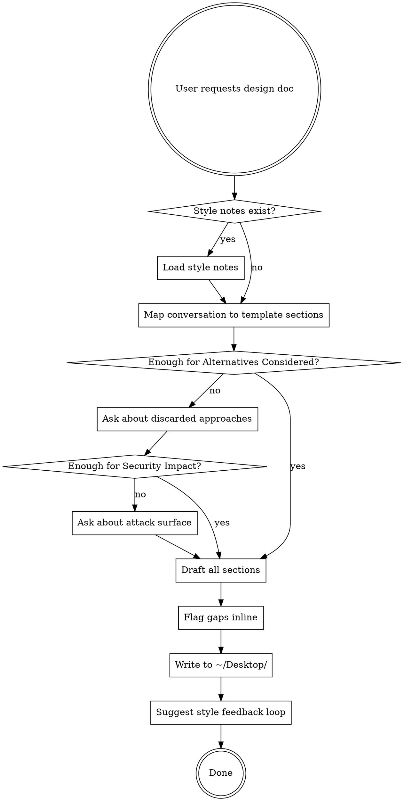

# Writing Design Docs

## Overview

Synthesize a conversation into a structured design doc draft using the Chainguard template. Output is a **structured brain dump** — content in the right sections, flagging gaps — not polished prose. The user will rewrite it in their own voice.

## When to Use

- User says "write a design doc", "turn this into a design doc", "let's write this up"
- You've been discussing a problem or design and the user wants to produce something shareable
- User wants an RFC or technical proposal following the Chainguard format

## Process



## Template

Every design doc MUST use these sections in this order. Do not invent your own structure.

1. **Title** — pithy, descriptive
2. **Overview** — 1-2 sentences on the intended impact. Not a summary of the doc.
3. **Background** — The problem, how it arose, why it's worth solving. No mention of the proposed solution. Assume the reader is new to Chainguard but not to cloud-native computing.
4. **Goals** — Bulleted. Specific, measurable outcomes.
5. **Non-Goals** — Bulleted. What's explicitly out of scope and why.
6. **Detailed Design** — The bulk. 1-4 pages. Avoid unnecessary detail and code snippets. Include expected cloud costs if relevant.
7. **Drawbacks** — Disadvantages, compromises. Opportunity costs, monetary costs, reliability, privacy, security.
8. **Security Impact** — Think like an attacker. Worst case if compromised or bypassed? Customer impact? Customer data or secrets involved? What makes you nervous?
9. **Alternatives Considered** — **This is the most critical section.** Enumerate discarded ideas with brief rationale. Shows due diligence and helps readers assess if the solution is appropriately sized.

## Rules

### Content style: structured brain dump

- Write **bullet points**, not paragraphs. Every section should be bullets or short fragments.
- If you catch yourself writing a sentence longer than ~15 words, break it into bullets.
- No topic sentences, no transitions, no concluding sentences. Just the content.
- The user will rewrite in their own voice — your job is to get the right content in the right place
- Load the `design-doc-prose-review` skill's reference files (`~/.claude/skills/design-doc-prose-review/references/`) and write to their rules

### Flag gaps explicitly

For any section where the conversation didn't provide enough material, add a visible marker:

```
> **GAP:** We didn't discuss [specific missing thing]. Consider: [suggested angles].
```

Do this inline within the section, not collected at the end.

### Pressure on critical sections

**Alternatives Considered:** If the conversation only explored one approach, STOP and ask the user about discarded ideas before drafting. Do not write this section with only one alternative or with vague placeholders. The template says this is the most critical section — treat it that way.

**Security Impact:** If the conversation didn't cover security, STOP and ask targeted questions: What's the worst case if this is compromised? Does it handle customer data or secrets? What component makes you most nervous? Do not write "none" or leave it thin.

### File output

- Write to `~/Desktop/<slugified-title>.md`
- Slug the title: lowercase, hyphens for spaces, strip special chars
- Example: "Offline Verification Bundles" -> `~/Desktop/offline-verification-bundles.md`

### After writing

Tell the user:

> When you've edited this into its final form, share the final version with me and I'll note the style differences for next time.

If the user shares a final version, diff it against the draft and add each new observation as a rule, with a wrong and a correct example, to the matching reference file of the `design-doc-prose-review` skill (`~/src/dotfiles/configs/claude/.claude/skills/design-doc-prose-review/references/`). Never write a separate style file.

## Common Mistakes

| Mistake | Fix |
|---------|-----|
| Using your own doc structure | Use the template above. Every section, in order. |
| Writing polished prose | Write structured notes. The user rewrites. |
| Thin Alternatives Considered | Ask the user. Don't guess. This section must show due diligence. |
| Skipping Security Impact | Ask targeted questions. Don't write "none." |
| Collecting gaps at the end | Flag gaps inline within each section. |
| Fabricating author/date metadata | Don't add metadata not in the template. |
| Dumping text to chat instead of a file | Always write to `~/Desktop/`. |
